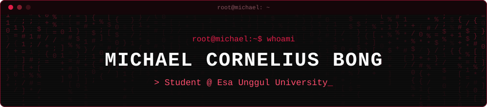

 

## 👨‍💻 About Me

Hi, I'm **Michael Cornelius Bong**, a student at **Esa Unggul University** who enjoys building software, from desktop logic in C++ to web and mobile apps.
I'm here to learn, build projects, and keep improving one commit at a time.

 

## 🛠️ Tech Stack

### Languages

      

### Frontend

   

### Backend

 

### Mobile

### Database

 

### Tools

  

 

## 📊 GitHub Stats

 

## 🚀 Currently

- 🎓 Studying at **Esa Unggul University**
- 🌱 Learning and building with **Laravel** and **Flutter**
- 🤝 Open to collaborating on student and open-source projects

 

## 📫 Contact

 