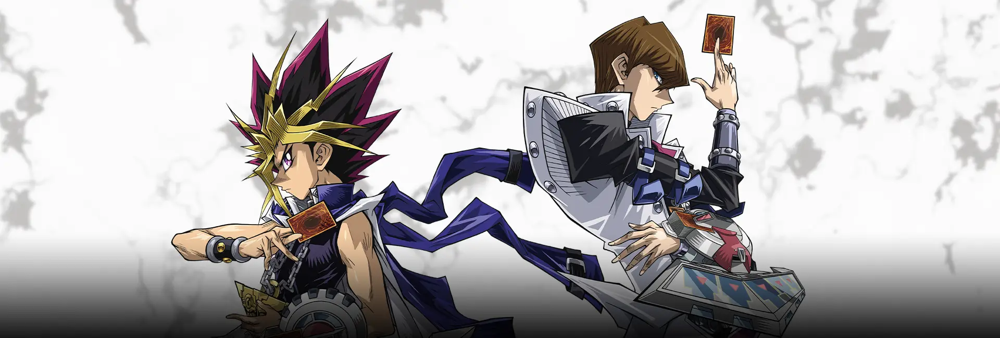

<b><i>“Live, even if it’s a sin.”</i></b>

 

## 👨‍💻 About Me

Hi, I'm Michael 👋 I'm a student who likes turning ideas into working software. I run my own server to keep learning how things work behind the scenes. Away from the keyboard I'm a competitive Yu-Gi-Oh! player, and it shapes how I work, plan a few turns ahead, know your resources, and always keep a backup play. I even run a website dedicated to Yu-Gi-Oh! Genesys. Feel free to take a look around. ⚔️

 

## 🛠️ Tech Stack

### Languages

      

### Frontend

   

### Backend

 

### Mobile

### Database

 

### Tools

  

 

## 💻 Dev Setup

  

| Hardware | Spec |
| :-- | :-- |
| 💻 Laptop | ASUS TUF Gaming A15 |
| 🎮 GPU | NVIDIA GeForce RTX 4050 |
| 🧠 RAM | 16 GB |

 

## 🖥️ Server Specs

   

| Component | Spec |
| :-- | :-- |
| 🏠 Type | Personal Server |
| ⚙️ CPU | Intel Processor |
| 🧠 RAM | 8 GB |
| 🐧 OS | Ubuntu Server |
| 🐳 Runs | Docker Containers |

 

## 🃏 Fun Facts

- 🐉 My favorite card is **Mirrorjade the Iceblade Dragon**
- ⚔️ I've been playing Yu-Gi-Oh! competitively since the **TOSS format**
- 🎮 I play **OCG**, **Master Duel**, and **Genesys**
- 🌐 I run a website dedicated to **Yu-Gi-Oh! Genesys**

 

## 🚀 Currently

- 🎓 Studying at **Esa Unggul University**
- 🌱 Learning and building with **Laravel** and **Flutter**
- 🤝 Open to collaborating on student and open-source projects

 

## 📫 Contact

 
